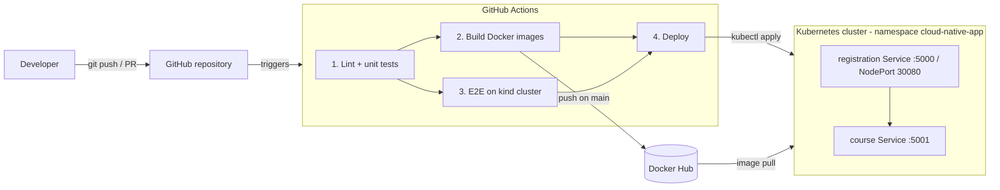

# Cloud-Native CI/CD Pipeline: GitHub · GitHub Actions · Docker · Docker Hub · Kubernetes

A two-microservice Flask application (**course** and **registration**) with a complete CI/CD
pipeline: every change is linted, tested, containerised, published to Docker Hub and deployed
to Kubernetes automatically.

> 👉 **Manual GitHub / Actions / Docker Hub / Kubernetes configuration is documented step by step in
> [`docs/SETUP.md`](docs/SETUP.md).**

## Architecture



**Application:** `registration` (port 5000) calls `course` (port 5001) over HTTP to validate a
course before enrolling a user. In Docker Compose and Kubernetes the service is simply called
`course`, so the same `COURSE_SERVICE_URL=http://course:5001` works everywhere.

## Repository layout

```
.
├── .github/workflows/ci-cd.yml   # the pipeline (test → build/push → e2e → deploy)
├── course/                       # course microservice  (app.py, Dockerfile, requirements, tests/)
├── registration/                 # registration microservice
├── k8s/
│   ├── namespace.yaml            # cloud-native-app namespace          (applied once, manually)
│   ├── rbac-ci.yaml              # least-privilege CI ServiceAccount   (applied once, manually)
│   ├── course.yaml               # Deployment + ClusterIP Service      (applied by pipeline)
│   └── registration.yaml         # Deployment + NodePort Service       (applied by pipeline)
├── scripts/
│   ├── smoke-test.sh             # end-to-end API checks (used by CI, CD and locally)
│   ├── generate-ci-kubeconfig.sh # builds the KUBE_CONFIG secret value
│   └── local-docker-commands.sh  # the original manual docker commands
├── docs/SETUP.md                 # ← manual setup guide
├── compose.yaml                  # local run with Docker Compose
├── requirements-dev.txt · pyproject.toml
```

## The pipeline

| Job | Runs on | What it does |
|-----|---------|--------------|
| **test** (matrix: course, registration) | PRs, pushes | `ruff` lint + `pytest` unit tests |
| **build** (matrix) | PRs, pushes | Builds each image with Buildx + layer cache. **Pushes** to Docker Hub only on `main`/tags, tagged `sha-<commit>`, `latest`, and `x.y.z` for `v*` tags |
| **e2e** | PRs, pushes | Spins up a throw-away **kind** cluster, loads the images, applies the real manifests, waits for the rollout and runs `scripts/smoke-test.sh` |
| **deploy** | pushes to `main` when `vars.DEPLOY_ENABLED == 'true'` | Applies the manifests with the immutable `sha-<commit>` tag, waits for rollout, smoke-tests, **auto-rolls back on failure**. Uses the `production` environment (optional manual approval) |

Design choices worth noting:
* **Immutable tags** – deployments reference the commit SHA, never `latest`, so every release is
  traceable and reversible.
* **Fork-safe** – PR runs never log in to Docker Hub and never see secrets.
* **Least privilege** – CI deploys with a namespace-scoped ServiceAccount, not cluster-admin.
* **Zero-downtime rollout** – `maxUnavailable: 0` + readiness probes.
* **Hardened containers** – non-root user, read-only root filesystem, dropped capabilities,
  resource limits, gunicorn instead of Flask's dev server.

## Run locally

```bash
# unit tests
pip install -r requirements-dev.txt
(cd course && python -m pytest) && (cd registration && python -m pytest)
ruff check .

# docker compose
docker compose up --build -d
./scripts/smoke-test.sh                       # defaults to http://localhost:5000
docker compose down

# try the API by hand
curl localhost:5000/courses
curl -X POST localhost:5000/register -H 'Content-Type: application/json' \
     -d '{"user": "User 1", "course_id": "CS01"}'
curl localhost:5000/registrations
```

## Run on Kubernetes manually (without the pipeline)

```bash
export DOCKERHUB_USERNAME=<you> IMAGE_TAG=latest
kubectl apply -f k8s/namespace.yaml
for f in k8s/course.yaml k8s/registration.yaml; do
  envsubst '${DOCKERHUB_USERNAME} ${IMAGE_TAG}' < $f | kubectl apply -f -
done
kubectl -n cloud-native-app get pods
```

## API

| Service | Endpoint | Description |
|---------|----------|-------------|
| course | `GET /health`, `GET /courses`, `GET /courses/<id>` | catalogue (CS01–CS03) |
| registration | `GET /health` | liveness/readiness |
| registration | `GET /courses` | proxies the course service |
| registration | `POST /register` `{"user","course_id"}` | 201 on success, 400/404/502/503 on error |
| registration | `GET /registrations` | enrolments recorded so far |

## Known limitations

* Registrations are stored **in memory** (as in the original code), so the registration Deployment
  is pinned to **1 replica / 1 gunicorn worker** and data is lost on restart. For real scale-out,
  replace the list with a database (e.g. PostgreSQL) and raise `replicas`.
* The `registration` Service is a `NodePort` for simplicity; use an Ingress or LoadBalancer in production.
* Natural extensions: Trivy image scanning, Helm/Kustomize, Argo CD (GitOps), Slack notifications.
